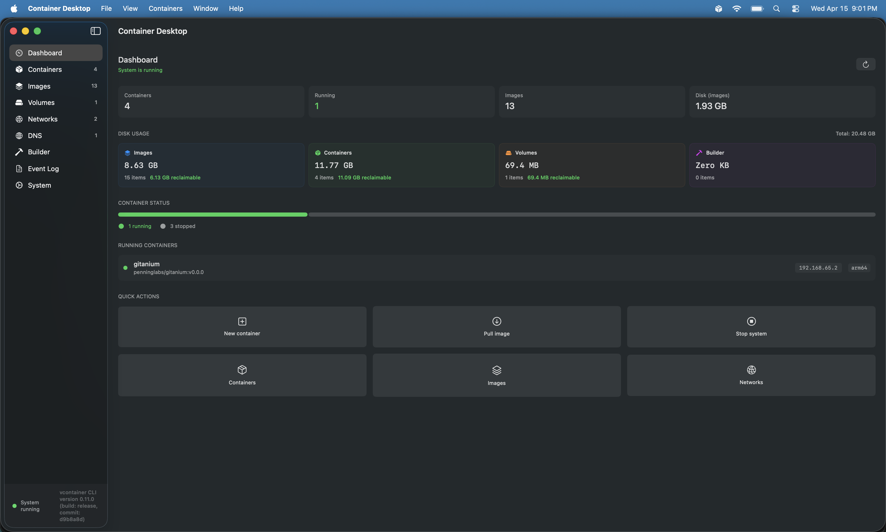
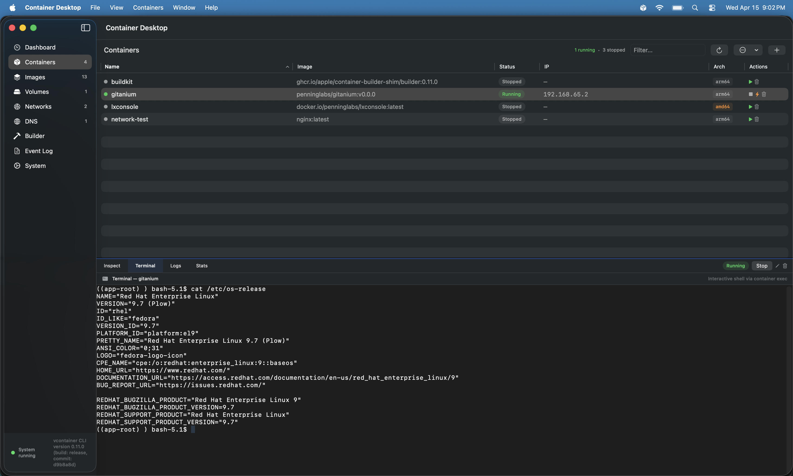
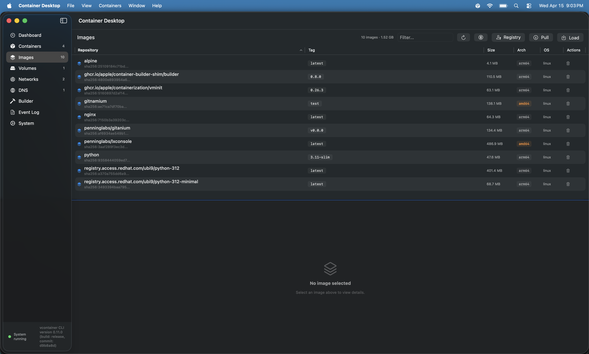

# Container Desktop

A native macOS GUI for [Apple's container CLI tool](https://github.com/apple/container) — think Docker Desktop, but for Apple Containers.

Container Desktop gives you a full graphical interface for managing Linux containers on your Mac without touching the terminal. Create, start, stop, and inspect containers. Pull, push, tag, and build images. Manage volumes, networks, and DNS domains. All from a native SwiftUI app that feels right at home on macOS.

> **Disclaimer:** Container Desktop is an independent, community-developed project by [Penning Labs](https://github.com/PenningLabs). It is not developed by, affiliated with, or endorsed by Apple Inc. "Apple", "macOS", and related trademarks are property of Apple Inc. This project uses Apple's open-source [container](https://github.com/apple/container) CLI tool, which is a separate project maintained by Apple.

## Screenshots







## Features

### Containers
- **Full lifecycle management** — create, start, stop, kill (SIGKILL), delete, and prune containers
- **Create and edit sheets** with all container options: ports, volumes, environment variables, DNS, network, resource limits, entrypoint, working directory, user, hostname, auto-remove, SSH agent forwarding, init process, nested virtualization, custom MAC address, and architecture selection
- **Detail panel** with five tabs: Inspect (JSON metadata), Terminal (full PTY via SwiftTerm), Logs (ANSI color rendering with disk-backed caching), Stats (CPU, memory, network, block I/O), and Files (copy files and folders in and out of a running container)
- **Disk cleanup** — reclaim unused space on a running container's root filesystem and named volumes (`container clean`)
- **Container export** — save a stopped container's filesystem as a tar archive

### Images
- **Pull** images from any OCI registry with progress tracking
- **Push** images to registries (Docker Hub, GHCR, Quay.io, or custom)
- **Tag** images with new references
- **Build** images from Dockerfiles with streaming step-by-step output, custom Dockerfile names, multi-architecture support, build arguments, target stages, and no-cache option
- **Save/Load** — export images to OCI tar archives and import them back (Docker interop: `docker save | container image load`)
- **Prune** dangling or all unused images
- **Architecture detection** — correctly identifies ARM64, AMD64, and multi-arch images from the image's platform variants

### Registry
- **Login/Logout** with support for Docker Hub, GitHub Container Registry, Quay.io, and custom registries
- View all logged-in registries with username and login time
- Credentials stored in the macOS Keychain by the container CLI
- Passwords passed via stdin (never visible in process list)

### Volumes
- Create (with optional size), delete, and prune volumes
- Detail panel showing volume info, containers using the volume, and Reveal in Finder

### Networks
- Create and delete custom networks with optional subnet configuration
- Network detail panel with container node cards
- Sortable table with state, mode, subnet, gateway, and container count

### DNS
- Create and delete local DNS domains (with sudo escalation via AppleScript)
- Enables hostname access to containers (e.g., `mycontainer.test` in your browser)

### Dashboard
- System status overview with container and image counts
- Disk usage breakdown (images, containers, volumes) from `container system df`
- Running container list and status bar visualization
- Quick actions for common tasks

### System
- Start/stop the container system service
- CLI version display
- System properties editor with inline editing (DNS domain, registry, builder config, kernel settings)

### Other
- **Keyboard shortcuts** for common actions
- **macOS notifications** for container lifecycle events
- **Application event log** with severity filtering and save-to-file
- **Input validation** at both UI and service layers with shell injection protection
- **Sensitive data redaction** in CLI error logs (environment variables, passwords)

## Prerequisites

### macOS Version
- **macOS 26 (Tahoe)** or later (recommended). The container CLI has limited networking support on macOS 15.
- Apple silicon Mac (M1, M2, M3, M4)

### Apple Container CLI
Container Desktop is a GUI frontend for Apple's `container` command-line tool. You must install it first.

1. Download the latest installer from the [container releases page](https://github.com/apple/container/releases)
2. Double-click the `.pkg` file and follow the installation instructions

   Or install via Homebrew:
   ```bash
   brew install container
   ```
3. Start the container system service:
   ```bash
   container system start
   ```
4. Verify the installation:
   ```bash
   container --version
   ```

If you see a version number (e.g., `1.6.1`), you're ready to go.

**Compatibility:** Container Desktop requires container CLI **1.0.0 or later** and is tested with **1.6.1**. Disk cleanup requires 1.4.1 or later. Copying files requires containers created on 1.0.0 or later; recreate older containers to use the Files tab.

### Xcode
- **Xcode 26** or later (for building from source)
- Xcode Command Line Tools: `xcode-select --install`

## Building from Source

### Quick Start

```bash
# Clone the repository
git clone https://github.com/PenningLabs/container-desktop.git
cd container-desktop

# Build and create the app bundle
chmod +x build-app.sh
./build-app.sh

# Install to Applications
cp -r "./build/Container Desktop.app" /Applications/

# Launch
open "/Applications/Container Desktop.app"
```

### Building with Xcode

1. Open the project directory in Xcode:
   ```bash
   cd container-desktop
   open Package.swift
   ```
2. Wait for Swift Package Manager to resolve dependencies (SwiftTerm)
3. Select the **ContainerDesktopApp** scheme and your Mac as the run destination
4. Press **⌘R** to build and run

> **Note:** When running as an SPM executable (not a `.app` bundle), the app activates as a foreground window automatically. If Gatekeeper blocks the built app, run:
> ```bash
> xattr -cr "/Applications/Container Desktop.app"
> ```

### Running Tests

```bash
swift test
```

Or in Xcode: **⌘U** to run all tests.

### Distribution

Container Desktop is distributed as a signed and notarized macOS application. All features are free and open source. Download the latest release from [GitHub Releases](https://github.com/PenningLabs/container-desktop/releases) or build from source.

If you find Container Desktop useful, consider supporting development via [GitHub Sponsors](https://github.com/sponsors/PenningLabs).

## Project Architecture

Container Desktop uses a 5-layer architecture:

```
SwiftUI Views → @Observable ViewModels → Service Protocols → CLI Services → container CLI binary
```

The **protocol-based service layer** decouples the UI from the CLI. All container operations go through service protocols, making the codebase easy to test and maintain.

### Source Layout

```
Sources/ContainerDesktop/
├── App/                    # App entry point, dependency injection, delegates
├── MenuBar/                # Menu bar commands and keyboard shortcuts
├── Models/                 # Data models (Container, Image, Volume, Network, etc.)
├── Services/
│   ├── CLI/                # CLI-based service implementations
│   └── Protocols/          # Service protocol definitions
├── Utilities/              # ANSI parser, formatters, notifications, event log, validation
├── ViewModels/             # @Observable view models
└── Views/
    ├── Builder/            # Dockerfile build UI
    ├── Containers/         # Container list, create/edit sheets, action buttons
    ├── Dashboard/          # System overview, disk usage, quick actions
    ├── DNS/                # DNS domain management
    ├── EventLog/           # Application event log viewer
    ├── Images/             # Image browser, pull/tag/push sheets, registry login
    ├── Network/            # Network topology and management
    ├── Settings/           # System settings (properties editor)
    ├── Shared/             # Reusable components (mount editor, port editor, etc.)
    ├── Sidebar/            # Navigation sidebar
    ├── System/             # System start/stop, version info
    ├── Terminal/            # PTY terminal emulator (via SwiftTerm)
    └── Volumes/            # Volume management
```

### Dependencies

| Dependency | Purpose |
|---|---|
| [SwiftTerm](https://github.com/migueldeicaza/SwiftTerm) | Full xterm/VT100 terminal emulator for the container exec terminal |

## Configuration

Container Desktop reads system properties from the `container` CLI. You can configure defaults in the **System → Properties** tab within the app, or from the terminal:

```bash
# Set default DNS domain for new containers
container system property set dns.domain test

# Set default registry
container system property set registry.domain docker.io

# Set default container resources
container system property set container.cpus 4
container system property set container.memory 2g
```

## Known Limitations

- **No GUI container support** — Apple Containers run headless Linux VMs. GUI apps require VNC or browser-based workarounds.
- **No Docker Compose equivalent** — multi-container orchestration requires creating containers individually.
- **DNS domain management** requires administrator privileges (prompted via macOS password dialog). Note: Apple's DNS server has a known bug ([GitHub issue #856](https://github.com/apple/container/issues/856)) where the DNS server starts but never populates records. Containers can still be accessed by IP address.
- **Networking features** are limited on macOS 15. macOS 26 is recommended for full networking support.

## Contributing

Contributions are welcome! Please see the [Apache 2.0 License](LICENSE) for terms.

When contributing:
- Follow the existing code style (SwiftUI views, `@Observable` view models, protocol-based services)
- Add tests for new service-layer functionality
- Validate CLI output parsing against real `container` CLI output
- Test on both ARM64 and AMD64 (Rosetta) containers

## License

Container Desktop is licensed under the [Apache License, Version 2.0](LICENSE).

Copyright 2026 Penning Labs.

---

Apple, macOS, Apple silicon, Xcode, and Swift are trademarks of Apple Inc., registered in the U.S. and other countries. Docker is a trademark of Docker, Inc. This project is not affiliated with or endorsed by Apple Inc. or Docker, Inc.
